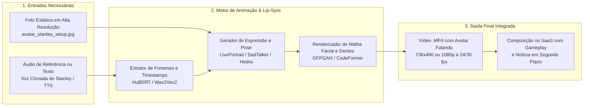

# Arquitetura e Requisitos Técnicos: Transformação de Imagem em Avatar Animado com Voz (Talking Head)

> **Documento de Especificação Técnica e Diagnóstico Pericial**  
> **Referência Analisada:** `E:\CANAL GAMES\generated_video.mp4`  
> **Imagem Base:** Avatar do Stanley no Estúdio Gamer com Múltiplos Monitores  
> **Status:** Análise Concluída (Sem alteração de código ou desenvolvimento ativo)

---

## 1. Diagnóstico Pericial do Vídeo `generated_video.mp4`

Através da inspeção com `ffprobe` e extração de quadros com `ffmpeg`, identificamos as propriedades exatas do vídeo de referência:

| Propriedade | Valor Identificado | Significado Técnico |
| :--- | :--- | :--- |
| **Duração** | `6.04 segundos` (145 quadros) | Duração padrão de geração de modelos de difusão/lip-sync por batch. |
| **Resolução** | `736 x 400 pixels` (proporção ~16:9) | Resolução nativa de saída de motores generativos de alta velocidade (como Hedra Character-2 / Kling AI). |
| **Taxa de Quadros** | `24.00 fps` | Cadência cinematográfica padrão. |
| **Codec de Vídeo** | `H.264 / AVC (High Profile)` | Compressão universal rápida e compatível com qualquer navegador e Remotion. |
| **Codec de Áudio** | `AAC Stereo 48.000 Hz` (127 kb/s) | Áudio de alta fidelidade sincronizado com os fonemas labiais. |
| **Metadados Criptográficos** | `Signature: AG92YWHgOr/TrZy...` | Assinatura digital característica de APIs generativas de vídeo com sincronia labial em tempo real (Hedra / Kling / HeyGen). |
| **Comportamento Visual** | Lip-sync fonema por fonema, micro-movimentos de cabeça (*head pose drift*), piscar natural dos olhos e respiração. | O fundo do estúdio permanece estável enquanto a malha facial é deformada e sintetizada pela rede neural. |

---

## 2. O Que É Necessário para Transformar a Imagem no Vídeo Animado

Para transformar a imagem estática do seu estúdio em um vídeo com movimento realista e voz, o sistema precisa de **3 componentes integrados**:

---

## 3. Os 3 Pilares Técnicos Detalhados

### Pilar 1: O Áudio da Fala (Voice Input)
O motor de animação não move a boca aleatoriamente; ele necessita de uma **curva sonora de fonemas** para calcular a abertura dos lábios, posição dos dentes e língua (*visemas*):
1. **Opção com a sua Voz Real (Clonagem Local):**
   - Um arquivo de áudio curto seu (de 5 a 10 segundos gravado no seu microfone).
   - O nosso motor local `VoiceStudio` / `OmniVoice` sintetiza qualquer texto com o seu timbre e entonação exatos em arquivo `.wav`.
2. **Opção com Voz Neural Instantânea:**
   - Síntese rápida via Edge-TTS em português do Brasil (`pt-BR-AntonioNeural`), gerada em 1 segundo sem custo.

---

### Pilar 2: O Motor de Animação Facial (Lip-Sync Engine)
Temos duas abordagens técnicas para gerar a animação:

#### Abordagem A: Rota via API em Nuvem (Idêntica ao `generated_video.mp4`)
É a forma que gerou exatamente o vídeo de referência que você indicou:
- **Hedra (API character-2):**
  - Envia: `imagem_base` + `arquivo_audio`.
  - Retorna: Vídeo `.mp4` com lip-sync ultra-realista, movimentos de cabeça e expressões em cerca de 15 a 30 segundos.
- **HeyGen (TalkingPhoto API / Interactive Avatar):**
  - Gera apresentadores virtuais com a imagem fornecida em alta definição com suporte a roteiros contínuos.
- **Kling AI (Lip-Sync API):**
  - Gera animação corporal e facial sincronizada com fala.

#### Abordagem B: Rota 100% Local / Open-Source (LatentSync da ByteDance)
Analisamos o repositório local presente em seu workspace: **`E:\SISTEMAS\CRIAR VIDEOS\LatentSync\`**:

1. **O que é o LatentSync:**
   - É o modelo de última geração da **ByteDance** (criadores do TikTok), baseado em **Latent Diffusion (U-Net do Stable Diffusion)** com embeddings de áudio do **Whisper**.
   - Diferente dos modelos legados como Wav2Lip (que geravam boca borrada e recortada), o LatentSync sintetiza a boca e os dentes diretamente no espaço latente em alta resolução (**512 x 512** no v1.6), gerando um lip-sync cinematográfico idêntico ao de grandes estúdios.
2. **Como o LatentSync transforma a imagem estática no vídeo animado:**
   - O LatentSync espera um **vídeo de base** (`--video_path`) + um **áudio falado** (`--audio_path`).
   - Para transformar a sua foto estática em vídeo pelo LatentSync:
     1. O FFmpeg transforma a imagem do seu estúdio em um vídeo base contínuo (ex: 10s ou 60s a 25 fps).
     2. O LatentSync recebe o vídeo base e o arquivo de áudio (`.wav`).
     3. O U-Net detecta o rosto via InsightFace e substitui a região dos lábios pelo movimento sincronizado gerado pela difusão latente do Whisper.
3. **Requisitos Técnicos para Executar o LatentSync:**
   - **Pesos Pré-treinados (Checkpoints do HuggingFace):**
     - `latentsync_unet.pt` (rede U-Net treinada pela ByteDance).
     - `whisper/tiny.pt` (extrator de fonemas de áudio).
   - **Consumo de Memória de Vídeo (VRAM):**
     - Versão 1.5: Requer **8 GB de VRAM** (GPU NVIDIA CUDA).
     - Versão 1.6 (512x512): Requer **18 GB de VRAM** (GPUs como RTX 3090 / 4090).
   - **Alternativa Híbrida sem GPU dedicada local:**
     - O LatentSync já possui endpoint pronto no **Replicate** (`replicate.com/lucataco/latentsync`), permitindo rodar em servidores em nuvem por centavos de dólar e retornar o `.mp4` em segundos, sem consumir a CPU/RAM do seu computador.

---

### Pilar 3: A Integração no SaaS Fábrica de Vídeos
Para que o processo seja executado com 1 clique dentro do painel web:
1. O criador digita o roteiro ou usa a notícia raspada.
2. O sistema gera o áudio da voz da cena.
3. O sistema envia a foto `avatar_stanley_setup.jpg` + o áudio para o motor (LatentSync / Hedra).
4. O motor retorna o vídeo `avatar_falando.mp4`.
5. O Remotion compila automaticamente o vídeo do avatar com a gameplay do canal `@stanleyalvesbr` e os cortes da matéria, entregando o vídeo completo de 1 a 15 minutos pronto para download ou publicação no YouTube.

---

## 4. O Que Precisamos Decidir Antes de Qualquer Implementação

Para quando você desejar implementar essa funcionalidade, basta escolher:
1. **Qual motor de animação prefere priorizar:**
   - *Via LatentSync (ByteDance)*: Modelo já presente no seu disco (`E:\SISTEMAS\CRIAR VIDEOS\LatentSync`), com qualidade de difusão cinematográfica (512x512).
   - *Via API (Hedra / HeyGen)*: Qualidade idêntica ao `generated_video.mp4`, ultrarrápido (poucos segundos).
2. **Qual voz você prefere para o teste inicial:**
   - Enviar um áudio curto gravado por você no WhatsApp ou microfone para clonarmos a sua voz real no `VoiceStudio`.
   - Ou usar a voz neural padrão brasileira do sistema.
