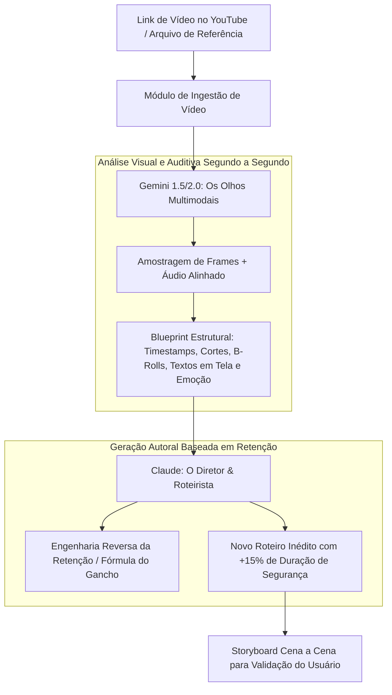
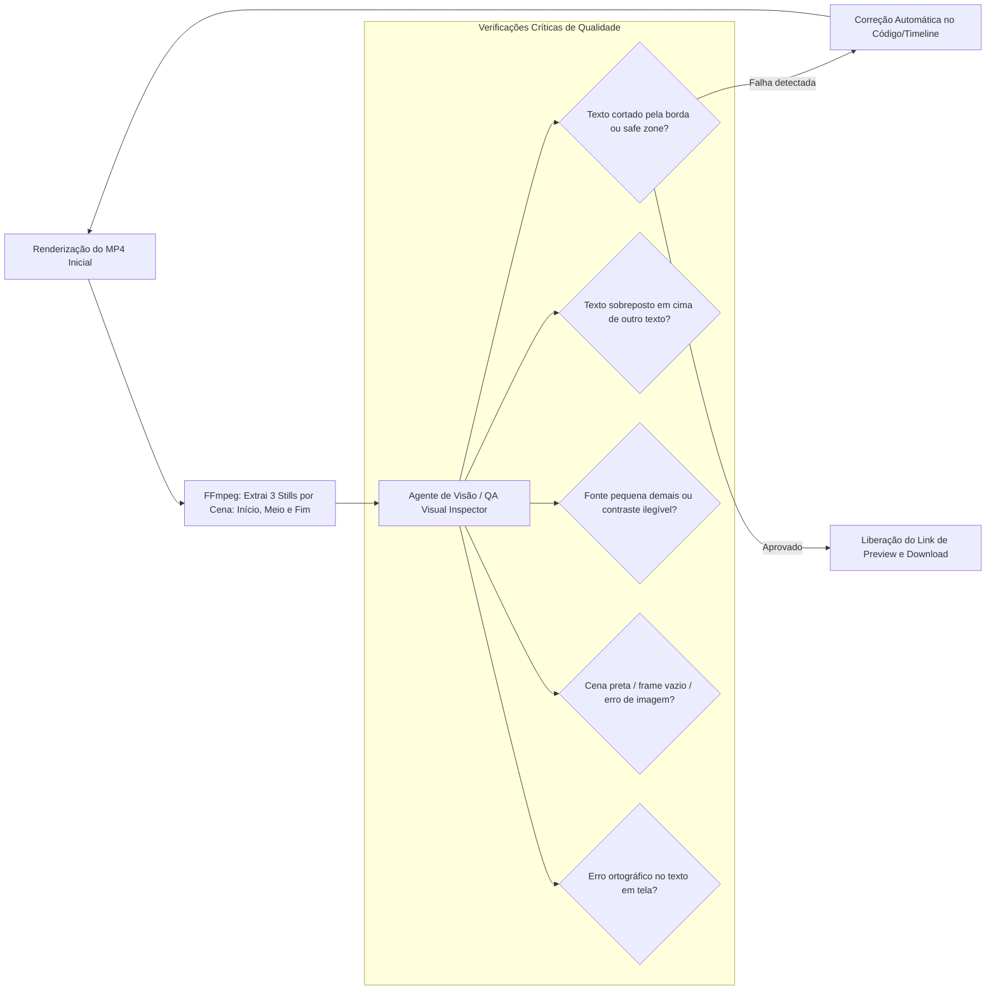

# Especificação Funcional e Arquitetural: SaaS Fábrica de Vídeos IA (V2)

> **Documento Diretor de Produto & Engenharia**  
> **Status:** Pronto para Início de Desenvolvimento  
> **Foco:** Radar de Nicho, Visão Multimodal de Vídeo (Engenharia Reversa), Briefing Guiado em Etapas, Auto-Inspeção Visual (QA) e Arquitetura Node-Based.

---

## 1. Visão do Produto e Fluxo de Valor

O SaaS é uma plataforma completa de **Inteligência e Criação de Vídeos**, dividida em dois grandes pilares que trabalham em harmonia:
1. **Radar de Mercado & Engenharia Reversa:** O criador ou empresa pesquisa o que está performando no seu nicho. O sistema **assiste visualmente** ao vídeo de referência (não apenas lê a legenda), entende a mecânica de retenção (cortes, transições, ganchos visuais e ritmo) e gera um roteiro autoral inédito.
2. **Esteira de Montagem Guiada & Blindada:** Transforma o briefing do usuário em um vídeo pronto através de um assistente por etapas, com aprovação prévia de storyboard, renderização determinística e **auto-inspeção visual automática de erros** antes da entrega.

---

## 2. Módulo de Inteligência: Radar de Nicho & "Visão" de Vídeo

### 2.1. O Problema da Transcrição Tradicional
Apenas baixar a transcrição do YouTube gera roteiros fracos porque:
- As legendas automáticas do YouTube contêm erros fonéticos graves.
- **Mais importante:** 70% do sucesso de um vídeo moderno está na **linguagem visual** (quando entra um B-roll, o texto na tela, as expressões faciais, gráficos e o ritmo de cortes a cada 2 a 3 segundos). O texto puro perde toda essa riqueza.

### 2.2. A Solução: Arquitetura em Dupla "Olhos & Cérebro"
Pesquisas de ponta e benchmarks de engenharia moderna revelam que a combinação ideal para "assistir e recriar" é:

1. **Os Olhos (Gemini Multimodal API):**
   - Ingestão do vídeo com análise temporal segundo a segundo.
   - Extrai um **Blueprint Técnico**:
     - *Timeline de cortes*: A que segundo houve troca de cena?
     - *B-rolls e gráficos*: Que tipo de imagem ou texto apareceu em cada instante?
     - *Gancho visual inicial*: O que prendeu o espectador nos primeiros 3 segundos?
2. **O Cérebro Roteirista (Claude 3.5 Sonnet / LLM Estratégico):**
   - Recebe o Blueprint Técnico e o tema do usuário.
   - **Regra de Ouro da Duração:** Se o usuário pediu um vídeo de 1 minuto, o roteiro é estruturado para **1 minuto e 10 a 15 segundos**. Isso garante que, após a locução natural, os cortes de silêncio e o ritmo de edição, o vídeo final nunca fique abaixo do tempo contratado.
   - Gera um roteiro 100% autoral, estruturado cena a cena, sem plagiar o conteúdo original, mas clonando sua fórmula de engajamento.

---

## 3. O Assistente de Criação (Briefing por Etapas no SaaS)

O formulário enviado pelo usuário foi convertido na jornada do cliente dentro do aplicativo web, estruturada em **6 Etapas Simples**:

### Etapa 1: Definição do Objetivo & Referência
- **Tema do Vídeo:** Campo de texto livre ou busca integrada de tendências do nicho.
- **Link de Referência (Opcional):** Espaço para colar o link do YouTube que o sistema deve "assistir" e se inspirar.

### Etapa 2: Formato & Duração
- **Proporção da Tela:**
  - `Vertical 9:16` (Reels, TikTok, Shorts).
  - `Horizontal 16:9` (YouTube Clássico, Cursos, Desktop).
  - `Quadrado 1:1` (Feed Instagram / LinkedIn / Anúncios).
- **Tempo Desejado:** Seletor de duração (ex: 30s, 60s, 90s, 3 min, 5 min) com margem automática de segurança.

### Etapa 3: Identidade Visual & Brand Kit
- **Estilo e Clima:** Seletor com cards visuais (Minimalista, Tecnológico/SaaS, Energético/Viral, Elegante/Documentário, Flat Motion, Anime).
- **Cores da Marca:** Seleção de cor primária, secundária e fundo (com detecção automática via logotipo).
- **Tipografia:** Escolha de fontes limpas (Inter, Outfit, Montserrat, Roboto).
- **Upload de Logo:** Upload do arquivo `.png` com fundo transparente.

### Etapa 4: Seus Arquivos (Ativos Próprios)
- **Upload de Mídia:** Área para arrastar vídeos gravados, fotos de produtos ou áudios próprios.
- **Biblioteca Interna:** Pastas organizadas por projeto para evitar misturar arquivos de clientes diferentes.

### Etapa 5: Áudio, Voz & Texto Obrigatório
- **Configuração Sonora:**
  - *Locução*: Voz IA (VoiceStudio/OmniVoice local ou ElevenLabs) ou áudio enviado pelo usuário.
  - *Música de Fundo*: Trilha sonora livre de direitos com auto-ducking (volume abaixa sozinho quando há fala).
  - *Efeitos Sonoros (SFX)*: Ativação de sons de transição (whoosh, pop, papel, digitação).
- **Legendas Inteligentes:** Escolha de estilo (Pílula, Karaokê, Caixa) com *safe zones* automáticas.
- **Textos Obrigatórios:** Chamada final para ação (CTA), site, cupom ou slogans que devem obrigatoriamente aparecer.

### Etapa 6: Aprovação do Storyboard (Antes de Renderizar)
- O sistema apresenta o plano cena a cena:
  - *Cena 1 (0s-3s)*: Gancho visual, texto na tela e narração.
  - *Cena 2 (3s-12s)*: Apresentação do problema com gráfico animado.
  - O usuário clica em **"Aprovar Roteiro"** ou edita diretamente o texto antes de gastar recursos de renderização.

---

## 4. Motor de Execução, HyperFrames/Remotion e Auto-Inspeção Visual (QA)

Um dos maiores diferenciais solicitados é o **controle de qualidade automatizado** antes da entrega ao usuário.

### 4.1. Verificação de Ambiente (Pre-Flight Check)
O sistema valida automaticamente antes do início do job:
- Node.js 22+.
- Binários do FFmpeg disponíveis no path.
- Instância headless do Chromium/Google Chrome para renderização em 60fps.
- Dependências e bibliotecas HyperFrames / Remotion operacionais.

### 4.2. Isolamento de Projetos
- Cada vídeo é gerado em seu próprio diretório hermético (`/projects/{project_id}/`), garantindo que nenhum arquivo de outro vídeo seja corrompido, sobrescrito ou deletado.

### 4.3. Motor de Auto-Inspeção Visual Automatizada (Visual QA Engine)
Antes de liberar o download para o usuário, o worker executa um algoritmo de validação de qualidade:

1. **Extração de Stills via FFmpeg:** O sistema extrai automaticamente 3 quadros por cena (no frame inicial, no ponto médio e no frame de transição).
2. **Inspeção por Visão Computacional:** O agente analisa as imagens verificando:
   - *Violação de Safe Zones*: Se o texto está colado demais na borda inferior do celular (onde ficam os botões do TikTok/Instagram).
   - *Colisão de Elementos*: Títulos cobrindo rostos ou logotipos.
   - *Legibilidade*: Contraste entre texto e fundo.
   - *Quadros Corrompidos*: Telas pretas ou assets não carregados.
3. Se for detectado qualquer defeito, o sistema ajusta as coordenadas no código e re-renderiza antes de incomodar o usuário.

---

## 5. Pesquisa de Concorrentes: O que Adotar no Nosso SaaS

A análise de plataformas líderes de mercado (como **Opus Clip**, **Crayo.ai**, **Treza Labs** e **InVideo AI**) revelou funcionalidades que devem ser incorporadas à nossa plataforma:

| Funcionalidade de Mercado | Plataforma de Referência | Como Aplicaremos no Nosso SaaS |
| :--- | :--- | :--- |
| **Score de Potencial Viral (Hook Score)** | Opus Clip | Dar uma nota de 0 a 100 para o gancho inicial do roteiro gerado, sugerindo 3 variações de gancho alternativo. |
| **Arquitetura Baseada em Nós (Node-Based Canvas)** | Treza Labs | Se uma cena específica não agradar ao usuário, ele não precisa renderizar o vídeo todo de novo: ele clica em "Regenerar apenas a Cena 3", economizando tempo e custo. |
| **UI Sintética de Produtos (Fake Screen Recording)** | OpenMontage | Animar capturas de tela estáticas com cursor virtual e cliques, permitindo criar vídeos de demonstração de qualquer site ou app em segundos. |
| **Split-Screen com B-Roll de Alta Retenção** | Crayo.ai | Permitir tela dividida (vídeo principal em cima, B-roll dinâmico ou animação 3D embaixo) para nichos de alta retenção no TikTok. |
| **Auto-Reframe com Detecção Facial** | Opus Clip / Submagic | Reenquadrar automaticamente vídeos 16:9 para 9:16 mantendo a pessoa sempre no centro visual. |

---

## 6. Regras de Ouro e Diretrizes de Entrega

1. **Comunicação Sem Jargões Técnicos:** O painel e o assistente falam a língua do usuário ("Tamanho para celular", "Cores da sua marca", "Volume da música"), sem expor termos como ffmpeg, bitrates ou codecs.
2. **Segurança de Direitos Autorais:** Bloqueio de publicação ou renderização com músicas ou marcas de terceiros sem a confirmação de uso comercial pelo usuário.
3. **Loop de Ajuste Amigável:** Após a entrega do vídeo final, o usuário tem botões de 1 clique: *"Trocar a cor do texto"*, *"Ajustar o volume da música"*, *"Mudar a voz"*, disparando apenas os ajustes necessários de forma instantânea.
